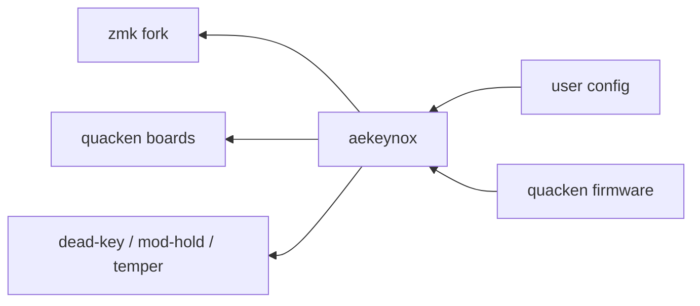

# Releasing

Release process of Ækeynox and the keyboards built on it, starting with Quacken.

## 1. Goals

- **Known content** — a release records the version of every repository its firmware is built from.
- **Reproducible** — building a release produces the same firmware at any date.
- **Cheap** — publishing a release takes a few clicks in GitHub, at the pace maintainers choose.

## 2. Overview

Each arrow is a version reference in `config/west.yml`.

- **Tags** — every repository versions its releases with protected tags; every arrow points to a tag.
- **Channels** — stable (`vX.Y.Z`), beta (`vX.Y.Z-beta.N`) for testers, edge (`main`) for the latest changes.
- **User template** — users customize a pinned Ækeynox release from their own repo, created with GitHub's _template_ feature; it holds only their configuration.
- **CI** — GitHub Actions prepares versions and changelogs, builds firmwares and publishes releases.

## 3. Getting a firmware

| Path                 | For                                                  | How                                                                                                       | Channels           |
| -------------------- | ---------------------------------------------------- | --------------------------------------------------------------------------------------------------------- | ------------------ |
| Prebuilt firmware    | users who want a working `.uf2` to flash             | download it from the Quacken releases: one zip per layout and OS, one `.uf2` per hold-tap and Vim variant | stable, beta, edge |
| User config template | users who want their own options or another keyboard | create a config repo from the template; its CI builds the custom firmware                                 | stable, beta, edge |

### User config template

Users create their config repo from the template (**Use this template** on GitHub):

| File                   | Purpose                                                                                  |
| ---------------------- | ---------------------------------------------------------------------------------------- |
| `config/west.yml`      | selects the Ækeynox version with `revision:` — a tag for stable or beta, `main` for edge |
| `config/settings.h`    | the user's options: uncomment the ones to enable                                         |
| `config/<keeb>.keymap` | `#include "settings.h"`, then `#include <aekeynox/keyboards/<keeb>.keymap>`              |
| `build.yaml`           | the keyboards to build                                                                   |

On each push, the repo's CI builds the firmware; the user downloads it from the Actions run. Updating Ækeynox means changing `revision:`.

### Fork (deprecated)

Building a firmware from a fork of `zmk-config-aekeynox` is deprecated. The README recommends the user config template.

Caveats:

- **Edge only** — **Sync fork** brings a fork to Ækeynox `main`; a fork cannot select a stable or beta version.
- **Sync conflicts** — user options live in `include/aekeynox/settings.h`, which upstream also modifies. Resolving the conflicts takes git skills many users lack.

Transition:

- **Existing forks** keep building: `include/aekeynox/settings.h` stays in Ækeynox, every option commented out.
- **Migration** — create a repo from the template, copy the uncommented lines of `include/aekeynox/settings.h` into `config/settings.h`.

## 4. How it works

**GitHub Actions** runs workflows (`.github/workflows/*.yml`):

- on repository events;
- on demand from the **Actions** tab.

**release-please** is a workflow running on each push to `main`:

1. it reads the commit messages since the last tag and computes the next version from their prefixes;
2. it opens or updates the release PR, which contains the version bump and the new `CHANGELOG.md` entries;
3. merging the release PR creates the tag and the GitHub Release.

PRs are squash-merged, so each PR title becomes the commit message release-please reads.

**Quacken release workflow** is started from the Actions tab with three inputs: the Ækeynox version to embed, the Quacken version to create, and the boards to build (`["flex"]` by default). It builds every firmware variant and publishes the GitHub Release.

The release commit sits outside `main`: the workflow creates a commit on top of `main` that only sets the Ækeynox `revision:` in `config/west.yml`, tags it and pushes the tag, which carries the commit. `main` keeps its own Ækeynox version, whatever version a release or pre-release embeds.

**`manifest.lock.yml`** is attached to each release: the exact commit of every repository the firmware is built from, generated by `west manifest --freeze`.

**Protected tags** — a tag ruleset (a GitHub repository setting) rejects the deletion and the move of tags. A published version always designates the same code.

## 5. Versioning rules

The Ækeynox public API is what users configure and feel: the `settings.h` options, the behaviors, the key placement.

| Bump  | When                                               | Commit                        |
| ----- | -------------------------------------------------- | ----------------------------- |
| major | key moved, option renamed/removed, default changed | `feat!:` / `BREAKING CHANGE:` |
| minor | new option, layout, keyboard                       | `feat:`                       |
| patch | fix                                                | `fix:`                        |

**Options marked experimental in `settings.h` are outside the SemVer contract**: they can change in a minor or patch release. Making an experimental option the default is a major release.

Quacken has its own version. A Quacken major ships a user-visible board change or a new Ækeynox major. Its release notes state the Ækeynox version.

| Repository                          | Tag                                                  |
| ----------------------------------- | ---------------------------------------------------- |
| Ækeynox, Quacken, behaviors, Temper | `vX.Y.Z`                                             |
| Ækeynox, Quacken beta               | `vX.Y.Z-beta.N`                                      |
| ZMK fork                            | `aekeynox-YYYY-MM-DD`, one per rebase onto a new ZMK |

## 6. Publishing

### Stable

1. Ækeynox: open the release PR (`release-please--branches--main` → `main`), check the version and the changelog, merge it → tag `vX.Y.Z`, GitHub Release, `manifest.lock.yml`.
2. Quacken: **Actions → Release → Run workflow**, `aekeynox_ref` = `vX.Y.Z`, `version` = the Quacken version.

### Beta

1. Ækeynox: push to `main` a commit with a `Release-As` footer:
   `git commit --allow-empty -m "chore: release X.Y.Z-beta.N" -m "Release-As: X.Y.Z-beta.N"`
2. Ækeynox: merge the release PR, now on `X.Y.Z-beta.N` → pre-release.
3. Quacken: run the workflow with `aekeynox_ref` = `vX.Y.Z-beta.N` and a `-beta.N` Quacken version.

### Edge

Quacken: run the workflow with `aekeynox_ref` = `main` and a `-beta.N` Quacken version → pre-release built from the current Ækeynox `main`.

### Dependency change

1. Tag the dependency (behavior, hardware module, ZMK fork).
2. Ækeynox: update its tag in `config/west.yml` through a PR, then release as above.

### Failed job

On a transient error (network, runner), once the run is over: **Re-run jobs → Re-run failed jobs** on the run page. The jobs that depend on it, such as the release publication, run again too.

## 7. Maintainer routine

| When                        | Action                                                                                                     |
| --------------------------- | ---------------------------------------------------------------------------------------------------------- |
| every PR                    | title prefixed per [Conventional Commits](https://www.conventionalcommits.org) (`feat:`, `fix:`, `feat!:`) |
| a batch of changes is ready | merge the Ækeynox release PR                                                                               |
| a Quacken release is wanted | run the Quacken release workflow                                                                           |
| a dependency changes        | tag it, update Ækeynox `config/west.yml`                                                                   |
| the ZMK fork is rebased     | tag it `aekeynox-YYYY-MM-DD` ,update Ækeynox `config/west.yml`                                             |
